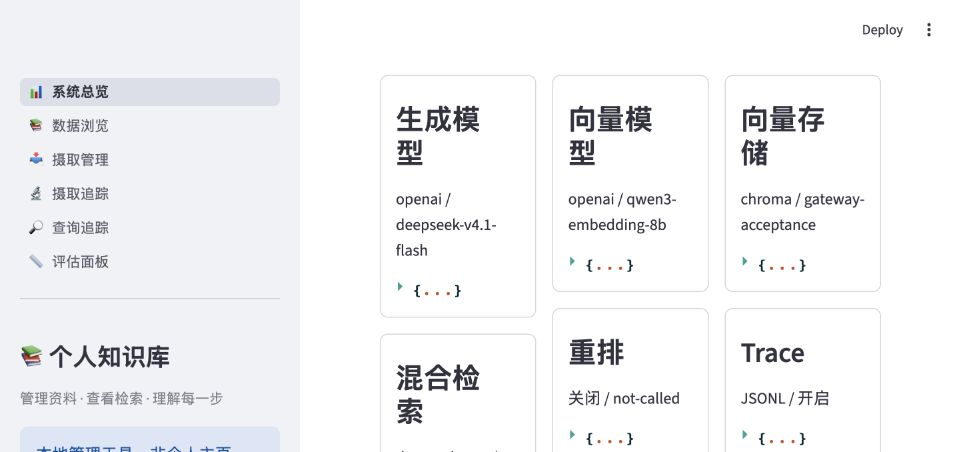

# Personal Knowledge MCP

面向个人知识库和 Agent 的模块化检索服务：把 PDF、Markdown 和文档图片整理成本地知识库，通过 MCP 为不同 AI 客户端提供带来源的检索证据。

项目提供摄取、混合检索、可选重排、可视化管理、链路追踪和评估。它是知识检索服务，不是完整聊天 Agent：MCP 工具返回证据，最终回答由宿主 Agent 生成；评估时也可以显式调用生成模型产生待评答案。

[系统架构](docs/架构导读.md) · [模型配置](config/settings.yaml) · [MCP 配置示例](config/mcp-portable.example.json)

## 功能概览

| 模块 | 能力 |
|---|---|
| 文档摄取 | PDF / MD / Markdown 解析、文件哈希查重、递归切分、批量编码与索引写入 |
| 图片处理 | 提取及管理文档图片、返回关联图片；可选视觉描述需单独配置支持的后端 |
| 混合检索 | Dense 向量检索 + BM25 关键词检索，使用 RRF 融合排名 |
| 重排 | 可选 LLM / 本地 Cross-Encoder，失败时保留诊断并回退 |
| MCP | 本地 stdio 服务，提供查询、集合列表和文档摘要三个工具 |
| 管理后台 | 六页 Streamlit 界面，浏览资料、执行摄取、删除索引、查看追踪与评估 |
| 可观测性 | 摄取与查询双链路 Trace，记录阶段输入、候选、状态和耗时 |
| 评估 | 固定题集批量运行、规则/Ragas/组合评分、质量门槛、显式候选题生成 |

模型、切分器、向量存储、重排器和评估器由配置与 Factory 选择。默认使用金山云星流的 `deepseek-v4.1-flash` 和 `qwen3-embedding-8b`，也保留其他模型 adapter。

## 快速开始

推荐 Python 3.12；以下命令从源码工作区运行。Windows 将 `.venv/bin/python` 换为 `.venv/Scripts/python.exe`。

```bash
git clone https://github.com/JJwanghaha/personal-knowledge-mcp.git
cd personal-knowledge-mcp
uv venv --python 3.12 .venv
uv pip install --python .venv/bin/python -e '.[dev,providers,splitters,vector-stores,sparse,vision,loaders,mcp,dashboard,evaluation]'
.venv/bin/python main.py --check
.venv/bin/python scripts/evaluate.py --check
```

检查命令不调用模型，也不创建知识库。已有环境无需重新创建。Ragas 固定为 0.4.3、langchain-community 固定为 0.4.1，避免已移除接口导致导入失败；Streamlit 需要 1.50 以上。

### 配置模型和 Key

默认配置的两项 `provider: openai` 表示选择 OpenAI-compatible adapter，不代表请求 OpenAI 服务：

```yaml
llm:
  provider: openai
  model: deepseek-v4.1-flash
  base_url: https://kspmas.ksyun.com/v1
  temperature: 0.0
  max_tokens: 4096
  timeout: 60.0

embedding:
  provider: openai
  model: qwen3-embedding-8b
  base_url: https://kspmas.ksyun.com/v1
  dimensions: 4096
  timeout: 60.0
```

这只是模型配置节选；完整配置见 [settings.yaml](config/settings.yaml)。可替换为自己的供应商和服务地址，不自动重试或跨供应商回退。

Key 通过启动进程环境提供。默认两种模型共用 `OPENAI_API_KEY`，其值是所选服务的 Key。macOS/zsh 可以隐藏输入：

```zsh
read -rs "OPENAI_API_KEY?输入模型服务 Key（不回显）："
export OPENAI_API_KEY
```

不要将 Key 写入 YAML、代码或公开日志。程序不自动加载 `.env`；若将 Key 保存在本机被忽略的 `.env` 中，需要由自己的启动环境或 MCP 宿主显式加载。GUI 程序不一定继承终端环境。

### 摄取与查询

```bash
# 预览候选文件：不读正文、不调用模型、不写入索引。
.venv/bin/python scripts/ingest.py --path /path/to/documents --collection personal --dry-run

# 正式执行会把文本发送给配置的模型服务。
.venv/bin/python scripts/ingest.py --path /path/to/documents --collection personal --verbose
.venv/bin/python scripts/query.py --query "这份资料能回答的问题" --collection personal --top-k 5 --no-rerank --verbose
```

各入口的集合与 `--data-dir` 必须一致。不指定数据根目录时使用仓库默认位置。

更换 Embedding 模型必须用新的数据根目录重建索引，不能混用不同向量空间，即使维度相同也不例外。历史查重按文件哈希，不区分模型或集合，仅换集合名可能跳过新编码。Qwen 示例采用服务实际返回的 4096 维，不在本地截断向量。

## MCP 接入

| 工具 | 用途 |
|---|---|
| `query_knowledge_hub` | 返回检索证据、来源引用、可选关联图片和 trace_id，不生成最终回答 |
| `list_collections` | 列出已有集合；count 表示 Chunk 数，不是文章数 |
| `get_document_summary` | 按引用中的 source_ref / doc_hash 回查已有摘要或正文预览 |

`main.py` 或安装后的 `mcp-server` 是本地 stdio 入口。stdout 专用于 MCP 协议，日志写 stderr；启动和列工具不调用模型，实际向量查询才调用 Embedding。

- [便携配置](config/mcp-portable.example.json)：适用于读取 mcpServers 格式的客户端。
- [VS Code 配置](config/mcp-vscode.example.json)：支持工作区路径和显式 envFile。
- [Claude Desktop 配置](config/mcp-claude.example.json)：合并到本机开发者配置，不覆盖其他服务器。

替换示例中的绝对路径和本机环境变量，不提交真实 Key。模板不等于宿主已接通，接入后应检查工具发现、集合选择、引用与 Trace。不同客户端的配置格式见 [VS Code 官方说明](https://code.visualstudio.com/docs/agent-customization/mcp-servers)及 [MCP 本地服务指南](https://modelcontextprotocol.io/docs/develop/connect-local-servers)。

## 管理后台

```bash
.venv/bin/python scripts/start_dashboard.py
# 可选 --port 8502 --config /absolute/settings.yaml --data-dir /absolute/data
```

访问 `http://127.0.0.1:8501/`，再从导航进入各页面：

| 页面 | 内容 |
|---|---|
| 系统总览 | 模型与检索配置、集合及实际文档/Chunk/图片计数 |
| 数据浏览 | Chunk 全文、metadata 和经过路径/格式校验的关联图片 |
| 摄取管理 | 上传资料及同级图片、进度、来源确认和索引删除 |
| 摄取追踪 | 解析、切分、增强、编码和存储映射 |
| 查询追踪 | Dense/BM25 候选、融合和重排名次变化 |
| 评估面板 | 题集审核、评分覆盖、逐题证据/答案、历史与候选题生成 |

浏览不调用模型；摄取、评估和出题要求明确确认。默认仅绑定 127.0.0.1，没有鉴权，不要暴露公网。



## 固定题集与评估

```bash
.venv/bin/python scripts/evaluate.py --check
.venv/bin/python scripts/evaluate.py --collection personal --test-set /path/to/reviewed.json --backend custom --top-k 5 --json
# 可选 --output /new/report.json --min-hit-rate 0.8 --min-mrr 0.5
# 显式 --generate-answers 会额外调用生成模型。
```

规则评分本身不调用模型，但 Dense 检索仍调用 Embedding。Ragas、生成答案和出题会额外调用模型并消耗额度。

| 后端 | 检查内容 |
|---|---|
| custom | 命中值、倒数排名；缺标签跳过，正常空召回且有标签时才计零 |
| ragas | 忠实度、回答相关性、无参考版本上下文精度；必须有真实待评答案 |
| composite | 分项合并及失败诊断，不把缺失分数补零或平均成总分 |

题集支持 expected_chunk_ids 和 expected_sources。前者优先；只标来源时明确是文档级命中。门槛要求有指标、全题评分覆盖、无执行错误和均值达标。报告保存题集 SHA256、语料指纹、参数、逐题结果和错误，不直接比较不同试卷或语料的分数。

reference_answer 不作为实际回答。可提供 generated_answer，或显式生成；生成提示不包含参考答案。候选题命令为：

```bash
.venv/bin/python scripts/generate_testset.py --collection personal --source /exact/indexed/source --count 10 --output /new/draft.json --confirm-model-call
```

它只保存 reviewed=false 草稿。必须人工核对证据与答案、设置 reviewed=true 后再固定用于评分，不自动出题后自评。

## 存储与隐私

| 默认位置 | 保存内容 |
|---|---|
| data/db/chroma | Chunk 正文、向量、元数据 |
| data/db/bm25/{collection} | BM25 倒排索引及最终 Chunk ID |
| data/db/ingestion_history.db | 文件哈希与处理状态 |
| data/db/image_index.db、data/images | 图片登记与受管理文件 |
| logs/traces.jsonl | 完整摄取/查询过程，可能包含私人正文 |
| data/uploads | 后台上传源；覆盖备份在 .history |
| data/evaluations | 私人评估报告与未审核草稿 |

资料、Key、索引、Trace、模型权重和报告不提交 Git。元数据字段过滤不是正文自动脱敏。

索引删除只清理选定来源在集合中的版本，不删除原始文档；未共享的受管理图片移到 data/images/.trash。删除不是跨存储事务，部分失败保留历史用于检查和重试。过去的 Trace 与评估报告不会随索引删除自动清理。

## 测试与验证

```bash
.venv/bin/python -m pytest -q
.venv/bin/python -m pytest -q tests/e2e
uv pip check --python .venv/bin/python
```

测试使用临时资料、真实解析/切分/Chroma/BM25/SQLite/MCP SDK 与评分算法，只在外部模型边界使用离线替身，不下载权重。公开样例已验证真实 Gateway 的摄取、检索、证据回答和六页后台；小样例高分不代表真实知识库质量。

无 Key 的整链路演示及产物审计：

```bash
.venv/bin/python scripts/offline_demo.py --output-dir /absolute/new-acceptance-directory
RAG_OFFLINE_ACCEPTANCE_ROOT=/absolute/new-acceptance-directory .venv/bin/python -m pytest -q
```

输出目录必须不存在，拒绝覆盖。未指定产物目录时，两条保存产物审计会跳过；明确选择缺失或不完整的产物必须失败。验收同时检查断言和进程退出码。项目在加载 ONNX Runtime 前关闭其原生遥测；Python socket 拦截不等同于操作系统断网沙箱。

## 已知限制

- 目前解析 PDF/Markdown，不支持 DOCX、OCR 或可靠的表格/版面结构化切分。
- 字符切分可能拆散代码、表格和图片标记；引用位置不等于可靠的原文偏移。
- 文件查重尚未关联集合、模型和编码配置；--force 不自动清理旧块或图片。
- Chroma、BM25、图片和历史没有跨库事务；管理模块目前绑定 Chroma。
- 重排、视觉描述和文本增强默认关闭；本地 Cross-Encoder 需自行准备权重，没有硬中断超时。
- 视觉后端目前为 Gemini/Azure，需要单独配置，不把默认 Gateway 文本模型当已接入的视觉后端。
- 当前是单用户本地 stdio 服务，没有 HTTP 远程部署或完整多用户权限控制。

## 附录

本项目的架构设计与实现思路参考了 [MODULAR-RAG-MCP-SERVER](https://github.com/jerry-ai-dev/MODULAR-RAG-MCP-SERVER)。
