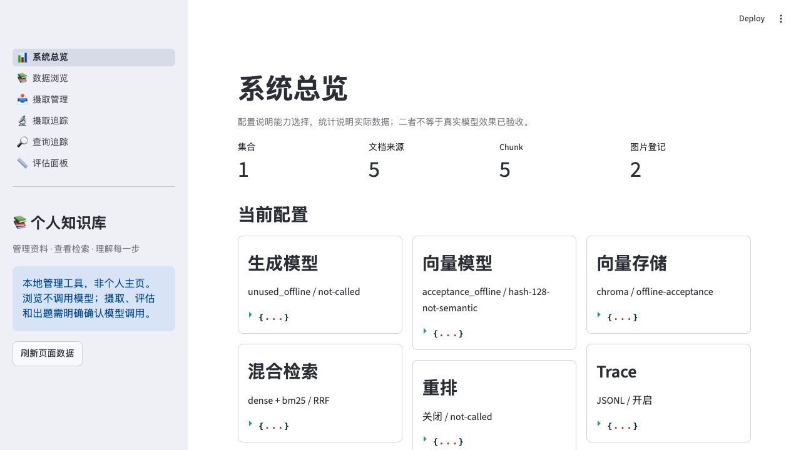
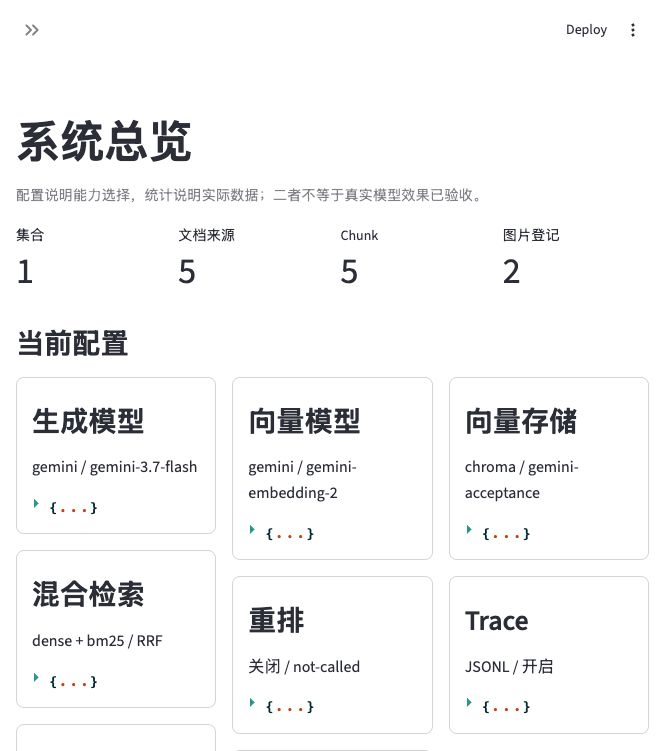

# 个人知识库 RAG MCP Server

参考 [jerry-ai-dev/MODULAR-RAG-MCP-SERVER](https://github.com/jerry-ai-dev/MODULAR-RAG-MCP-SERVER)，从零学习并实现的模块化知识库。当前分支：`learning/from-zero`。

支持 PDF/Markdown 摄取、Dense＋BM25＋RRF 检索、可选重排、MCP 三工具、中文管理后台、Trace、固定测试集评估与质量门槛。查询工具返回证据，不生成最终答案；评估中的答案生成是独立显式操作。

2026-10-12：A–I 第一版已实现。当前为金山云 Gateway 的 `deepseek-v4.1-flash`＋`qwen3-embedding-8b`（4096 维）；五份公开/合成样例走通真实摄取、CLI/MCP、三题证据回答/规则评估与六页后台，无检索降级。配置切换后全量 821 项通过（0 跳过、退出码 0），保留 5 条既有警告。个人知识库质量、实际 Agent 宿主与公开主页未验收，当前不是生产级权限或多租户系统。

[架构导读](docs/架构导读.md) · [上游开发规格](DEV_SPEC.md)

## 1. 安装与无 Key 快速开始

以下从源码工作区运行，当前验收使用 Python 3.12。Windows 将 `.venv/bin/python` 换为 `.venv/Scripts/python.exe`。

```bash
uv venv --python 3.12 .venv
uv pip install --python .venv/bin/python -e '.[dev,providers,splitters,vector-stores,sparse,vision,loaders,mcp,dashboard,evaluation]'
.venv/bin/python main.py --check
.venv/bin/python scripts/evaluate.py --check
.venv/bin/python scripts/offline_demo.py
```

已有虚拟环境时无需重新创建。依赖包括 Streamlit>=1.50、Ragas==0.4.3、langchain-community==0.4.1；固定后两者避免新版删除旧接口导致 Ragas 无法导入。

`offline_demo.py` 不需要 Key，拒绝 Python socket 出站连接，只用公开样例和词项哈希向量替身；这是程序内防线，不是操作系统断网沙箱：

- 在新的 `data/acceptance/随机ID` 目录摄取 MD、PDF 和本地图片，再检查重复跳过。
- 从 CLI 与官方 MCP stdio 子进程检索，检查三工具、引用、摘要、图片和错误后连接恢复。
- 在同一语料上执行 TopK=1 固定题集评估，检查命中率/MRR、覆盖与门槛。
- 用 AppTest 渲染后台六页，核对摄取/查询 Trace 已完成。
- 保留 `acceptance.json`、隔离配置、数据、Trace、评估报告和 MCP stderr。旧目录不会覆盖，不自动删除任何工作资料。

这证明工程流程可复现，不证明真实模型的语义质量。离线配置仅供该演示入口及浏览结果，不能当生产模型配置。I 阶段完整记录在独立学习文档仓库。

离线测试用于回归，不能代替真实验收。此前 Gemini 生成的 503/504 保留为历史失败记录；用户随后授权双模型都改走公司 Gateway。新样例库全部重新生成 Qwen 向量，没有复用 Gemini 或哈希向量。三题 TopK=1 命中率/MRR 均为 1、覆盖各 3/3，真实生成答案经人工对照证据；这不是个人知识库质量基线。图片仅解析/保存/返回，视觉描述、文本增强、重排和 Ragas 本次未启用。

## 2. 真实模型与资料：先用一份小文档

默认生成是 `deepseek-v4.1-flash`，Embedding 是 `qwen3-embedding-8b`、4096 维，均走 `https://kspmas.ksyun.com/v1`，超时 60 秒。两项 `provider: openai` 表示复用 OpenAI-compatible adapter，不代表请求 OpenAI 服务；不自动重试或切换供应商。地址/型号由 `config/settings.yaml` 指定。

程序不会自动读 `.env`。Key 必须出现在启动进程的环境中；不要写入 YAML、源码或公开日志。macOS/zsh 可由你在自己的终端隐藏输入：

```zsh
read -rs "OPENAI_API_KEY?输入公司 Gateway Key（不回显）："
export OPENAI_API_KEY
```

也可由宿主显式加载已配置的环境文件。当前双模型都读 `OPENAI_API_KEY`；这是公司 Gateway Key，不需要另申请 OpenAI Key。旧 Gemini adapter/Key 可保留，默认不使用。GUI 启动的后台或 Agent 不一定继承终端环境，设置 Key 后需要从正确环境重启对应进程。

```bash
# 预览候选文件，不读正文、不调用模型、不写入索引。
.venv/bin/python scripts/ingest.py --path /path/to/selected-note.md --collection manual_check --dry-run

# 以下真实发送文档/问题给 Embedding 服务并写入存储，执行前确认资料可发送及额度。
.venv/bin/python scripts/ingest.py --path /path/to/selected-note.md --collection manual_check --verbose
.venv/bin/python scripts/query.py --query "这份文档能回答的问题" --collection manual_check --top-k 5 --no-rerank --verbose
```

各入口的 `--data-dir` 必须一致；不指定时用仓库默认路径。切换 Embedding 模型或维度后应重新建索引，不能把不同空间混在同一集合。

重建时用全新的数据根目录，而不只是改集合名：历史查重仍按文件哈希，不区分模型/集合，否则旧成功记录可能跳过新编码。当前 Qwen 使用网关实际返回的 4096 维，adapter 不发送自定义 dimensions，也不本地截断；配置维度用于校验输出。

## 3. 配置与数据位置

| 配置 | 职责 |
|---|---|
| `llm` / `embedding` | 模型供应商、型号、超时；不保存 Key |
| `vector_store` | Chroma 持久化目录 |
| `ingestion` | 切分字符数/目标重叠、批量大小；可选文本增强 |
| `retrieval` | 两路召回量、融合量、RRF k |
| `rerank` | 重排开关、后端、最终条数；默认关闭 |
| `vision_llm` | 可选图片描述；默认关闭 |
| `observability` | 日志级别、Trace 开关和文件路径 |
| `evaluation` | 规则/Ragas/组合评分及指标；默认不自动评估 |

| 默认位置 | 保存内容 |
|---|---|
| `data/db/chroma` | Chunk 正文、向量、元数据 |
| `data/db/bm25/{collection}` | 倒排索引，以最终 Chroma ID 回查正文 |
| `data/db/ingestion_history.db` | 文件哈希与处理状态 |
| `data/db/image_index.db`、`data/images` | 图片登记与受管理文件 |
| `logs/traces.jsonl` | 每行一次完整摄取/查询过程，包含私人正文 |
| `data/uploads` | 后台上传源；覆盖备份在 `.history` |
| `data/evaluations` | 私人报告与未审核草稿 |

资料、凭据、索引、Trace 和权重不提交 Git。字段过滤不是正文自动脱敏。

## 4. 本地管理后台

```bash
.venv/bin/python scripts/start_dashboard.py
# 可选 --port 8502 --config /absolute/settings.yaml --data-dir /absolute/data
```

先访问 `http://127.0.0.1:8501/`，再从导航进入六页：

1. 总览：配置、集合、实际文档/Chunk/图片计数。
2. 数据浏览：完整块、metadata、受路径/格式校验的关联图片。
3. 摄取管理：PDF/MD/Markdown 与同级图片附件、六阶段进度、源路径确认后删除。
4. 摄取追踪：解析、切分、增强前后、编码统计和存储映射。
5. 查询追踪：Dense/BM25 候选、融合、重排名次变化。
6. 评估面板：审核试卷、评分覆盖、逐题结果、门槛、历史与显式候选题生成。

浏览不调用模型；摄取、评估和出题要求明确确认。删除只清理所选来源在集合内的索引版本，不删除源文件；受管理图片移到 `data/images/.trash`，恢复文件后仍需恢复登记。多存储操作不是事务，部分失败保留历史用于重试。

只绑定 127.0.0.1，没有鉴权，不要暴露公网。

离线验收的实际总览：1 个集合、5 份公开/合成文档、5 个 Chunk、2 张图片。这里的哈希向量不代表 Gemini 效果。



历史 Gemini 库的总览（当时生成未通过，卡片只表示配置）：



当前 Gateway 双模型的实际配置卡片，已完成真实样例调用：


## 5. MCP 接入

服务提供：

| 工具 | 返回 |
|---|---|
| `query_knowledge_hub` | 检索证据、来源引用、可选图片与 trace_id |
| `list_collections` | 已有集合；count 是 Chunk 数，不是文章数 |
| `get_document_summary` | 按 source_ref/doc_hash 回查已有摘要或预览 |

`main.py` 和安装后的 `mcp-server` 是 stdio 入口，stdout 专用于协议，日志在 stderr。启动/列工具不创建模型或空知识库，实际查询才使用配置的 Embedding。当前 SDK 固定 1.x，真实宿主仍需检查协议协商。

配置样例：

- [VS Code 格式](config/mcp-vscode.example.json)：复制到 RAG 工作区的 `.vscode/mcp.json`，支持显式 `envFile`，不要把真实 Key 提交。
- [便携 mcpServers 格式](config/mcp-portable.example.json)：替换绝对路径；VS Code 新 Agent Host 优先使用工作区 `.mcp.json` 或用户便携配置。
- [Claude Desktop](config/mcp-claude.example.json)：通过开发者配置合并，不要覆盖现有其他服务器；Key 只在本机配置。GUI 不保证继承终端环境。

这些是连接模板，不代表本机宿主已接通。VS Code 格式与便携格式的区别见 [官方说明](https://code.visualstudio.com/docs/agent-customization/mcp-servers)，stdio/`envFile` 见 [配置参考](https://code.visualstudio.com/docs/agents/reference/mcp-configuration)；Claude Desktop 配置入口见 [MCP 官方本地服务指南](https://modelcontextprotocol.io/docs/develop/connect-local-servers)。交互式 `${input:...}` 不会转发到新 Agent Host，不假设所有宿主使用同一种密钥加载方式。

本轮未修改任何实际宿主配置。接入后需真实检查工具发现、选定集合、引用与 Trace，再确认验收。

## 6. 固定题集与评估

```bash
.venv/bin/python scripts/evaluate.py --check
# 实际执行仍调用检索 Embedding；Ragas 和生成答案额外调用 LLM。
.venv/bin/python scripts/evaluate.py --collection manual_check --test-set /path/to/reviewed.json --backend custom --top-k 5 --json
# 可选 --output /new/report.json --min-hit-rate 0.8 --min-mrr 0.5
```

- custom：规则计算命中值、倒数排名。缺标签跳过，正常空召回有标签才计零。
- ragas：忠实度、回答相关性、无参考版本上下文精度；必须有真实待评答案。
- composite：分项合并，失败明确记录，缺指标不填 0，不平均成总分。

题目支持 `expected_chunk_ids` 和 `expected_sources`；ID 优先，只有来源标签时明确是文档级命中。报告保留试卷 SHA256、语料指纹、参数、逐题证据/答案、错误/跳过和评分覆盖数。门槛要求有指标、全题覆盖、无执行错误和均值达标，检索阈值必须大于零。

`reference_answer` 不作为实际回答。可提供 `generated_answer`，或显式使用 `--generate-answers`；生成提示词不包含参考答案。

`scripts/generate_testset.py --collection ... --source /exact/indexed/source --count 10 --output /new/draft.json --confirm-model-call` 只生成 `reviewed=false` 草稿，逐字核验证据后关联实际 Chunk ID。必须人工审核问题和答案、设置 `reviewed=true` 后固定评分，不自动出题后自评。当前候选题以单来源、单片段为基线。

## 7. 测试与验收边界

```bash
.venv/bin/python -m pytest -q
.venv/bin/python -m pytest -q tests/e2e
uv pip check --python .venv/bin/python
```

测试用临时资料、真实 parser/Splitter/jieba/Chroma/BM25/SQLite/官方 MCP 客户端/Ragas 算法；只在外部模型 seam 用离线替身，不下载权重。PyMuPDF 的 5 条 SWIG 弃用警告保留。

默认测试不依赖某次本机演示的随机目录；两条已保存产物审计会跳过。要完整复现该部分，先在全新目录执行演示，再显式选择它：

```bash
.venv/bin/python scripts/offline_demo.py --output-dir /absolute/new-acceptance-directory
RAG_OFFLINE_ACCEPTANCE_ROOT=/absolute/new-acceptance-directory .venv/bin/python -m pytest -q
```

选定的目录不存在或证据不完整时必须失败，不算跳过或通过。检查测试断言之外，还要检查进程退出码为 0。

项目 `src` 入口在加载 Chroma/ONNX Runtime 前设置 `ORT_DISABLE_TELEMETRY=1`，关闭它的原生遥测；这也避免了本轮 macOS 后台遥测线程退出崩溃。仅在导入后调用 Python 关闭接口不足以阻止初始化事件，见 [ONNX Runtime 1.30 官方隐私说明](https://github.com/microsoft/onnxruntime/blob/v1.30.0/docs/Privacy.md)。不改用户系统环境或第三方源码；如果外部程序已经先导入 ONNX Runtime，再导入本项目，不保证初始化前关闭。

Gateway 双模型已通过五份公开样例的真实主链路验收。后续仍需审核个人资料可发送范围、建立真实语料的固定问题集和质量基线、验证实际 Agent 宿主；不把三题样例高分包装成通用召回率。

## 8. 常见问题与已知限制

- `main.py` 启动后不退出：stdio 正在等客户端，诊断用 `--check`。
- 找不到 Key：`.env` 不自动加载；确认正确启动进程环境，不把 Key 贴到聊天或日志。
- 集合为空/找不到：检查摄取成功、集合名和各入口 `--data-dir` 一致，读取不会创建空库。
- Ragas 导入报错：安装 `.[evaluation]` 的固定兼容版本，不仅看安装成功或元数据检查。
- 重排没执行：默认关闭；Cross-Encoder 需准备本地权重且没有硬中断超时，不自动下载。
- 文件重复跳过：历史主键仍是内容哈希，不区分集合/模型/配置；`--force` 重做不会自动清理旧 Chroma 块或图片。
- Markdown 表格、代码、图片标记可能被字符切分拆散；未实现可靠版面/偏移、DOCX/OCR。
- BM25 与向量/图片/历史没有跨库事务，更新、删除和恢复需检查各库状态。
- 当前 DocumentManager 绑定 Chroma；metadata 读删不是所有 BaseVectorStore 的通用能力。
- MCP 不提供 HTTP 远程部署；没有完整多用户 ACL。个人主页的公开资料范围与权限要单独设计。

## 参考与学习记录

架构和 A–I 顺序以作者项目 [固定源码 f658c5a](https://github.com/jerry-ai-dev/MODULAR-RAG-MCP-SERVER/tree/f658c5a4011c8b826707a65a3b11ce9301b0626f) 为基线；本地加入 Gemini、Markdown、安全图片回查、明确评分失败/覆盖和可复现离线验收等适配。保留上游来源，不把离线证明写成生产或真实模型效果。

更详细的中文学习与工程过程记录维护在独立的 `00-planning` 文档仓库，代码仓库只保留运行必需说明。`DEV_SPEC.md` 保留上游原始任务表，未打勾不等于本地未实现。
