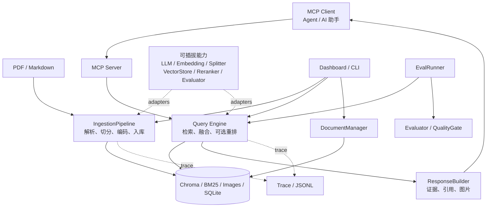

# 系统架构

Personal Knowledge MCP 由摄取、检索、存储、MCP、管理后台、追踪与评估组成。不同入口共享业务模块，不各自实现一套 RAG。

## 模块关系



MCP 的查询工具返回证据，由宿主 Agent 决定怎样组织回答。评估中的答案生成是显式、独立的模型调用，不改变查询工具职责。

## 摄取链路

```text
文件 → SHA256 查重 → Loader → Document
    → DocumentChunker / Splitter → Chunk[]
    → 可选 Transform → Dense / Sparse 编码
    → Chroma / BM25 / Images / SQLite
```

Loader 负责将不同格式统一成 Document，并提取图片与元数据。切分后生成带 ID、来源和图片关联的 Chunk；增强、编码和索引写入在其后执行。只有处理完成才记录成功，失败记录允许重试。

Integrity SQLite 的哈希主键目前不包含模型或集合。换 Embedding 模型必须使用新的数据根目录重新编码，不能只换集合或混入原来的向量空间。

## 查询链路

```text
问题 → 关键词 / 过滤条件
    → Dense + BM25 → RRF
    → 可选 Reranker → ResponseBuilder
    → 文本证据 / 引用 / 关联图片 / trace_id
```

Dense 通过问题向量召回候选，BM25 通过词项统计召回候选。RRF 融合名次而不是相加不同尺度的原始分数。重排只能调整已经召回的候选；检索降级或重排回退单独记录，不当作正常成功。

CLI 与 MCP 使用 query_service 创建同一组检索组件。后台的 DataService/EvaluationService 复用摄取、管理和评估模块；入口负责交互确认、结果展示和资源收尾。

## 可插拔能力

| 能力 | 统一接口 | 当前实现 |
|---|---|---|
| 文本生成 | BaseLLM | OpenAI-compatible、Gemini、Azure、DeepSeek、Ollama |
| 视觉描述 | BaseVisionLLM | Gemini、Azure |
| 文本向量 | BaseEmbedding | OpenAI-compatible、Gemini、Azure、Ollama |
| 文本切分 | BaseSplitter | RecursiveSplitter |
| 向量存储 | BaseVectorStore | ChromaStore |
| 重排 | BaseReranker | None、LLM、Cross-Encoder |
| 评分 | BaseEvaluator | Custom、Ragas、Composite |

Factory 根据 provider 配置创建 adapter；上层依赖统一接口。相同接口不意味着所有后端都有完全一样的管理能力：metadata 读删和 DocumentManager 当前绑定 Chroma，其他存储实现不能无条件替换。

## 存储分工

| 存储 | 内容与用途 |
|---|---|
| Chroma | Chunk 正文、向量和 metadata，用于向量召回与 ID 回查 |
| BM25 JSON | 词频、倒排索引和最终 Chunk ID，用于关键词召回 |
| Images / SQLite | 受管理图片及来源/集合登记，用于关联图片返回 |
| Integrity SQLite | 文件内容哈希、处理状态和时间，用于查重与重试 |
| Trace JSONL | 双链路阶段、候选、错误和耗时，用于诊断 |
| Evaluation JSON | 试卷/语料指纹、参数、真实答案与评分覆盖，用于回归 |

DocumentManager 协调选定来源的多存储删除，保留原始资料。未共享的受管理图片移到 .trash，历史 Trace 和评估报告不自动删除。多存储写入与删除不是跨库事务，失败必须检查后再重试。

## 评估与追踪

EvalRunner 读取已审核固定题集，调用现有检索与可选重排，再交给 Evaluator。Custom 计算标签命中与倒数排名；Ragas 判断证据/答案质量，需要真实待评答案；Composite 合并分项指标和错误，不平均成总分。

QualityGate 检查指标存在、全题覆盖、执行错误和显式阈值。缺标签、执行异常和全部跳过不应伪装成评估通过。参考答案不用于生成待评回答，自动出题只生成待审核草稿。

TraceContext 在业务阶段记录输入、结果、状态和耗时，由 TraceCollector 收尾保存。阶段耗时可因并行检索重叠，不简单相加当作总耗时。Trace 与报告可能包含私人正文，不应公开上传。

## 运行边界

- 本地 stdio MCP 与仅绑定 127.0.0.1 的 Streamlit 后台，不提供公网鉴权。
- 支持 PDF/Markdown 与文档图片，不提供 DOCX/OCR 或可靠表格结构保护。
- 默认关闭视觉描述、文本模型增强和重排；选择后端不等于真实效果已验证。
- 无 Key 演示替换外部模型，真实模型验证必须另行检查；两类结果不能混同。

运行、配置和 MCP 接入步骤见 [README](../README.md)。
